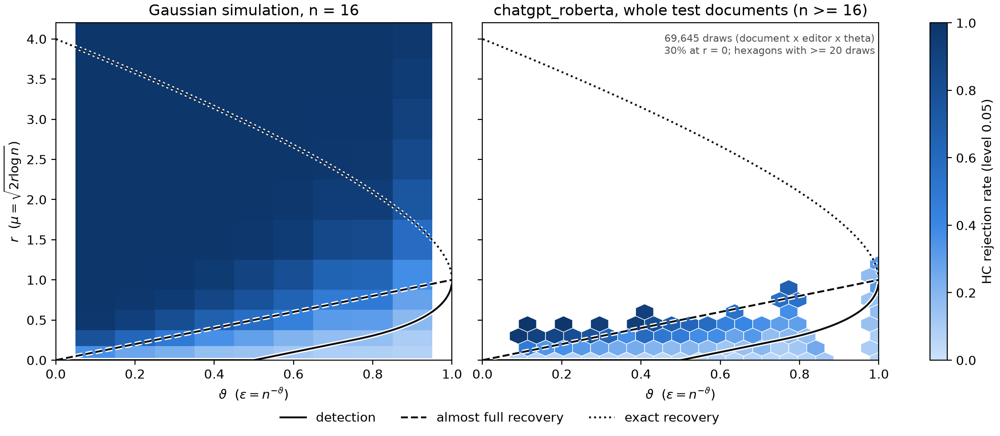
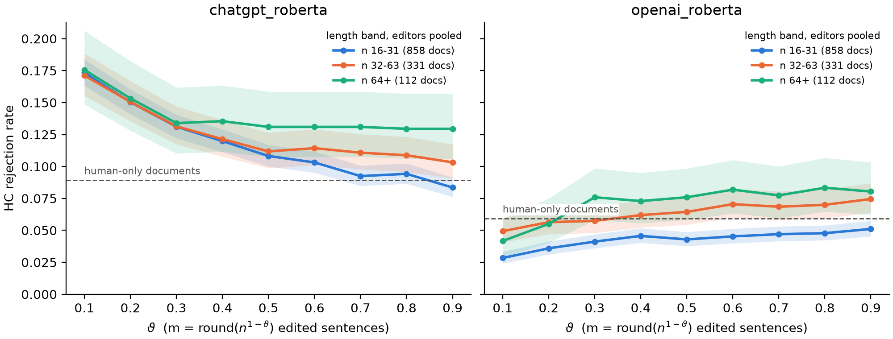
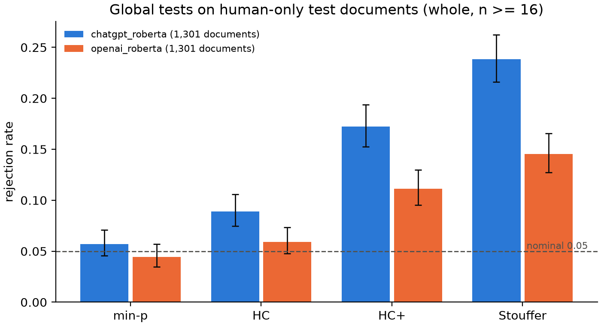

# Pilot results: off-the-shelf detectors on the frozen corpus (2026-11-01, Rui)

Preliminary. First run of score → calibrate → phase on the real corpus (sha256 8fba77d9, editing round 1), with two
detectors that need no training and run on a laptop. The point was to check the pipeline end to end on real data
and get first numbers while the fine-tuned and 7-8B zero-shot detectors are pending.

## What was run

- **Detectors** (`score_pretrained.py`, used as released): `openai_roberta`, the OpenAI GPT-2 output detector
  (2019), and `chatgpt_roberta`, the HC3 ChatGPT detector (2023). Score = logit(AI) − logit(human), each sentence in
  isolation, on calib and test only (514,005 versions, about 25 minutes per detector on an Apple M4).
- **Calibration**: unchanged `calibrate.py` (per-source conformal p-values, 10 length bins, about 15,000 calib
  sentences per source); no NaN p-values.
- **Phase**: whole mode on test documents with at least 16 sentences (1,301 documents, review item 46) and windows of
  16 and 32; 6 editors (3 models × edit/light); theta in {0.1, ..., 0.9} plus human-only documents; conformal null.
- **Not run**: the Falcon-7B zero-shot scores (too large for 16 GB; a Falcon3-1B pair ran at 2 sentences/s, 66 h),
  ModernBERT, the embedding baseline.

Code: branches `rui/ci-eps` (intervals, ε̂, per-document output, `report.py`), `rui/doc-lengths` (PR #4),
`rui/lm-splits` (`score_pretrained.py`, calib/test-only scoring). Outputs stay local under `data_dir`.

## 1. Per-sentence signal is weak or absent

AUC of edited vs human test sentences (all sources; 0.5 = no signal):

| editor | openai_roberta | chatgpt_roberta |
|---|---|---|
| gemma-4-31b | 0.483 | 0.619 |
| gemma-4-31b-light | 0.509 | 0.610 |
| gpt-oss-120b | 0.399 | 0.540 |
| gpt-oss-120b-light | 0.423 | 0.546 |
| qwen3.5-122b | 0.460 | 0.609 |
| qwen3.5-122b-light | 0.483 | 0.609 |

- `openai_roberta` has no signal; it scores edited sentences as slightly *more* human (gpt-oss most).
- `chatgpt_roberta` has a real but weak signal: the median edited z (`mu_eff`) is 0.6-0.9 on ELLIPSE, 0.2-0.5 on
  PERSUADE, Enron, FineWeb-Edu and OpenReview, and about 0 on peS2o, WritingPrompts and XSum.
- gpt-oss edits are the hardest to detect for both. Light and full edits score about the same, although light
  edits change about half as many words (median 25% vs 50%).

## 2. HC detects only where the theory says a weak signal can be detected



Each edited test document (one draw per editor and theta) is placed at its own theta = 1 − log m / log n and
r = max(mean edited z, 0)² / (2 log n), and binned; colour is the share HC rejects. r uses the true edit positions
and the same z the test sees, so this placement is descriptive, not an estimate. Most mass sits at r < 0.5, below
the almost-full-recovery line, and 30% of draws at r = 0.



For `chatgpt_roberta`, HC rejects 17.3% of edited documents at theta = 0.1 (dense), 11.1% at 0.5 and 9.2% at 0.9,
against 8.9% on human-only documents: detectable when dense, indistinguishable from the null when sparse. A shift of
z ≈ 0.4 at n = 16 is r ≈ 0.03, far below the detection boundary for theta > 1/2 (r = 0.2 at theta = 0.7), so this
is the expected behaviour of a weak detector, not a failure of HC. Support recovery fails everywhere (BH exact
recovery 0%, Hamming error / m ≈ 1). `openai_roberta` stays at or below its null rate at every theta.

[phase diagram, openai_roberta](figures/pilot/phase_openai_roberta.png)

## 3. Within-document dependence breaks the global tests' null



On human-only documents (whole, n ≥ 16, 1,301 documents, nominal 0.05):

| test | openai_roberta | chatgpt_roberta |
|---|---|---|
| min-p | 0.045 | 0.057 |
| HC | 0.059 | 0.089 |
| HC+ | 0.111 | 0.172 |
| Stouffer | 0.145 | 0.238 |

With synthetic i.i.d. scores on the same test split (whole documents, before the length cutoff) Stouffer is 0.046, so the inflation comes from the text. The
intraclass correlation of human sentence z within test documents is 0.07-0.28 per source for `chatgpt_roberta`
(ELLIPSE 0.28, PERSUADE 0.23) and 0.02-0.09 for `openai_roberta`: a document's sentences share author and topic, so
their scores move together. Tests that pool many moderate p-values (Stouffer, HC+) suffer most; min-p, which uses
only the smallest, holds its level. The Monte Carlo thresholds in `stats.null_thresholds` assume independence
(review items 41, 44), so every power number above is measured against an inflated null.

**Proposed fix** (review items 41, 58-60):
1. Split the calib split by document into two halves: one stays the conformal null; the other gets p-values against
   it and serves as human documents for the null of the global tests (this also fills `hc_variants.calib_window_z`).
2. Estimate the within-document dependence per source from that half: an exchangeable correlation rho (one parameter,
   works for any n), or a Toeplitz Sigma (`hc_variants.toeplitz_covariance`).
3. Thresholds by Monte Carlo under that Sigma (`hc_variants.null_thresholds_dependent`) instead of i.i.d. uniforms,
   per source and n; check that type I error on human-only test documents returns to 0.05.
4. Alternatively, PC-adjusted / innovated HC (Lecture 4) to remove the shared component before testing; this also
   removes part of a dense signal, so it suits the sparse cells.

## 4. Edited fraction

With these detectors the estimators carry little information. Storey's estimate stays at 0.16-0.24 for
`chatgpt_roberta` whatever the true fraction (0.04-0.66); the Meinshausen-Rice lower bound is about 0.01 and covers
in 95-100% of draws (95.1% at theta = 0.9, where dependence pushes it toward the nominal level).

## Next

1. The fine-tuned ModernBERT (Ege) through the same pipeline: the run most likely to place documents in the
   detectable region. The 7-8B zero-shot scores need a GPU (RunPod).
2. A valid null under dependence (above), then power against it.
3. ε̂ per cell (all documents pooled) instead of per document.
4. Comparisons for the report: detector strength vs detectability, held-out editor (Qwen), sources, light vs full.

Reproduce (with `data_dir` pointing at a built `versions.parquet`):

```bash
uv run python -m sparse_edits.score_pretrained
uv run python -m sparse_edits.calibrate
uv run python -m sparse_edits.phase --what simulate
uv run python -m sparse_edits.phase --what empirical
uv run python -m sparse_edits.report
```
